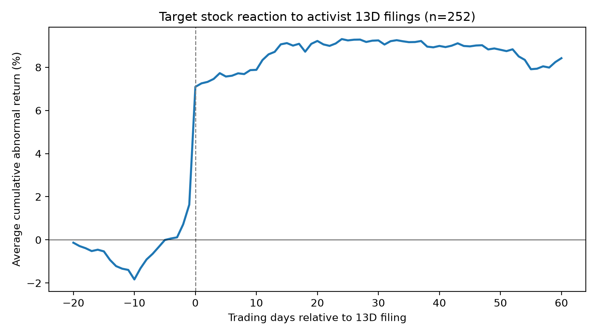
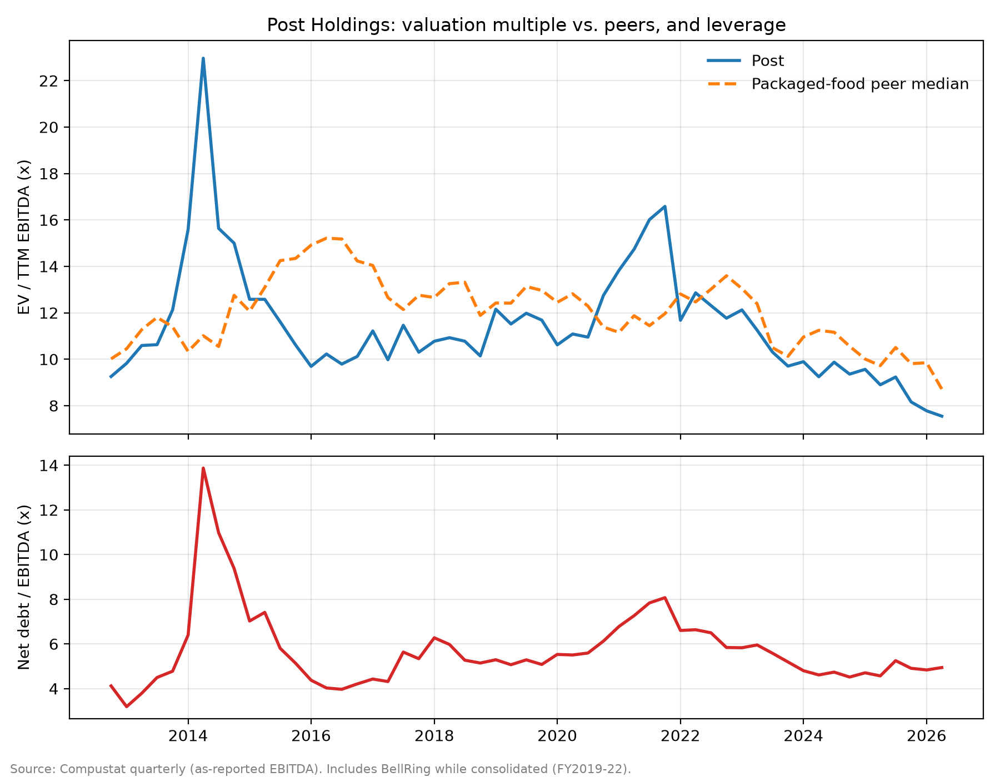

# Predicting Activist Hedge Fund Targets

An end-to-end research project that collects every major activist campaign since 2010 from SEC filings, measures how target stocks reacted, trains a model to predict which companies activists will target next, and applies it to produce a full activist pitch on the model's top-ranked large company, Post Holdings.

**Author:** James Foehner, B.S. Data Science, Northeastern University (Khoury College), expected May 2027

---

## Key findings

**1. Activist campaigns create an immediate, lasting jump in value.**
Across 252 campaigns by eight major activists (Elliott, Starboard, Trian, ValueAct, Pershing Square, Third Point, Icahn, Jana), target stocks beat the market by **6.5% over the three days around the 13D filing** (t = 12.9; 81% of targets rose) and by about **10.8% over the surrounding month**. The gains did not reverse.



**2. The long-term payoff comes from targets getting sold.**
One-year returns versus the market averaged only about 3% and were not statistically significant. Split by outcome, targets acquired or delisted within a year beat the market by about **18%**, while targets that stayed public roughly matched it. On announcement day the market could not yet tell the two groups apart.

**3. Targets can be predicted well above chance.**
A model trained only on information public at the time ranked companies each year from 2016 to 2025, tested out of sample:

| Model | ROC AUC | Targets caught in top 10% | Top 1% vs. base rate |
|---|---|---|---|
| Random | 0.50 | 10% | 1x |
| Size only (baseline) | 0.65 | 6% | 0x |
| Logistic regression | 0.73 | 23% | 4.5x |
| Gradient boosting | 0.75 | 26% | 4.5x |

It ranked Mentor Graphics in its top 0.4% months before Elliott's 2016 campaign, and Caesars, GoDaddy, and Symantec in their top 1% before their campaigns. Targets tend to be large, cheap on EBITDA relative to peers, more indebted, and coming off a weak year for the stock. Strong profitability, strong recent returns, and large cash balances make a company *less* likely to be targeted.

**4. Case study: Post Holdings.**
Post ranked third of about 2,500 U.S. companies. The full pitch, [`case_study/post_holdings_activist_memo.html`](case_study/post_holdings_activist_memo.html), argues for selling Weetabix, paying down debt, and then spinning off Foodservice. The Excel model, [`case_study/Post_Deleveraging_Model.xlsx`](case_study/Post_Deleveraging_Model.xlsx), compares that plan with the company's current debt-funded buybacks:

| Value per share, end of FY2029 | Base case | Downside case |
|---|---|---|
| Status quo | $121 | $76 |
| Plan, no spin-off | $111 | $81 |
| Plan + Foodservice spin-off | $128 | $94 |
| *Price today (Oct. 2026)* | *$76.83* | *$76.83* |

The pitch also documents a hypothesis that failed. Post's own history showed **no** re-rating when its debt was lower: it has traded at about 87% of peer multiples at every level of leverage. The thesis was rebuilt around that persistent discount, and none of the valuation cases above assumes the market re-rates Post.



---

## How it works

```
SEC EDGAR ─► 1. edgar_13d_activists.py   259 initial 13D filings by 8 activists, 2010–2026
                     │
WRDS (CRSP) ─► 2. event_study.py          Abnormal returns around each filing (252 matched)
                     │
WRDS (Compustat + CRSP) ─► 3a. build_panel.py   44,282 firm-years: 14 peer-relative features + labels
                     │
                3b. train_model.py         Walk-forward test 2016–2025; score current companies
                     │
                4. post_comps.py, post_history.py, Excel model, memo   Case study
```

**Phase 1: Campaign data** (`src/edgar_13d_activists.py`). This script downloads EDGAR's quarterly indexes, keeps Schedule 13D filings, and reads each filing's SEC header to confirm the activist is the filer rather than the subject. It also records the target's identifiers, industry code, and exact acceptance time. Manual exclusions for filings that are not campaigns, such as debt restructurings, activist-sponsored SPACs, and duplicate refilings, are listed with reasons in `data/exclusions.csv`.

**Phase 2: Event study** (`src/event_study.py`). Each target is linked to CRSP using the identifier link valid on the campaign date, with a name-match fallback, so acquired and delisted companies stay in the sample. Delisting returns are included. Filings accepted after the 4pm close are measured from the next trading day. Outputs include market-adjusted and market-model abnormal returns, plus one-year buy-and-hold returns.

**Phase 3: Prediction model** (`src/build_panel.py`, `src/train_model.py`). Annual Compustat data is treated as public four months after fiscal year-end, and stock-return features use only prior months. Each firm-year is labeled 1 if a campaign begins within the following 12 months. Features are measured against 2-digit SIC industry peers. Testing is walk-forward: to predict year *Y*, the model trains only on years up to *Y − 2*, because year *Y − 1*'s outcomes were not yet fully known.

**Phase 4: Case study.** Comparable-company multiples come from Compustat daily prices and quarterly financials, and a quarterly history of Post's valuation versus peers runs back to 2012. These feed an Excel model (status quo vs. activist plan, base and downside cases, spin-off scenario, sensitivity tables) and a written investment memo.

---

## Reproducing the results

Requirements: Python 3.11+, and a [WRDS](https://wrds-www.wharton.upenn.edu/) account with CRSP and Compustat access.

```bash
python3 -m venv .venv && source .venv/bin/activate
python -m pip install -r requirements.txt
./run_all.sh "Your Name your_email@example.com" YOUR_WRDS_USERNAME
```

The SEC requires a real name and email in the User-Agent for EDGAR requests. The first run takes a while, since it downloads about 68 EDGAR quarterly indexes and full Compustat and CRSP histories. Everything is cached locally afterward, and reruns take minutes.

**Data licensing:** Compustat and CRSP data are licensed through WRDS and are **not** included in this repository. `.gitignore` excludes raw pulls and row-level outputs. The figures show aggregated results only.

---

## Limitations

- **The model only sees 13D campaigns.** Activists holding under 5%, which is common at mega-caps like Elliott's AT&T campaign or Ancora's 2025 CSX campaign, file no 13D, so those companies are labeled "not targeted." Some negative labels are wrong for the same reason, and the activist list covers only eight funds.
- **Small number of positives.** There are 189 labeled targets and 87 in the test years, so performance estimates are noisy.
- **Stale features for the current screen.** Scores use each company's latest annual report. Several top-ranked companies had already recovered, merged, or attracted another activist, so every name needs a news and filings check before it is taken seriously.
- **Case study assumptions** include the Weetabix sale multiple, tax leakage, spin-off costs, and the spun-off company's multiple. They are flagged in the model's input sheet and the memo's risk section.

## Repository structure

```
├── src/                     Pipeline scripts, run in the order shown in run_all.sh
├── data/
│   ├── exclusions.csv       Filings removed as non-campaigns, with reasons
│   └── post_segments.csv    Post segment EBITDA from public earnings releases
├── figures/                 Aggregated charts
├── case_study/              Post Holdings Excel model and investment memo
├── requirements.txt
└── run_all.sh
```

## Selected references

- Brav, A., Jiang, W., Partnoy, F., & Thomas, R. (2008). Hedge fund activism, corporate governance, and firm performance. *Journal of Finance*, 63(4), 1729–1775.
- Greenwood, R., & Schor, M. (2009). Investor activism and takeovers. *Journal of Financial Economics*, 92(3), 362–375.

---

*Independent student research project. Not investment advice.*
