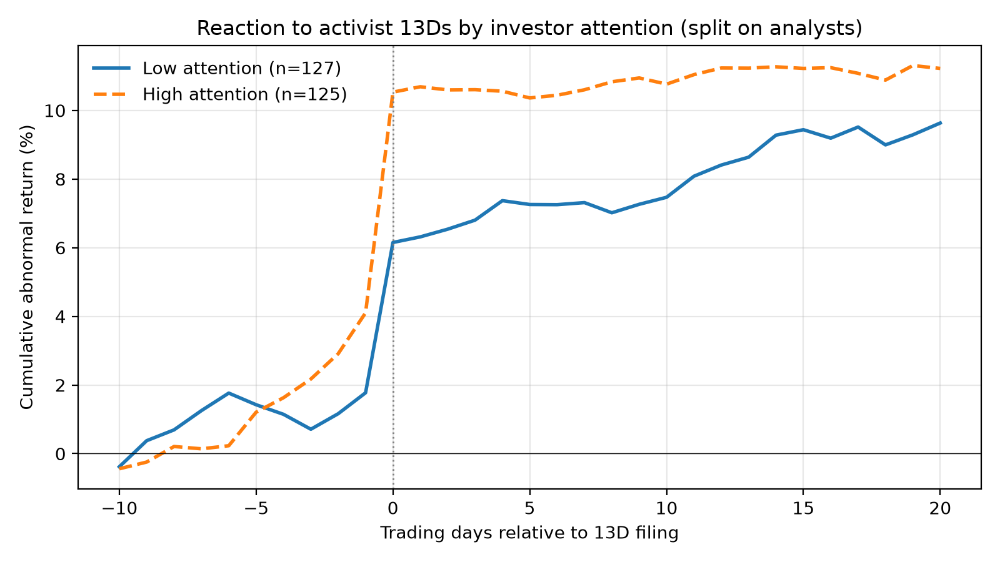

# Do Activist Filings Reach Prices Slowly? Evidence on Gradual Information Diffusion

**James Foehner** · Part of the [activist target screener](../README.md) project · November 2026

## Summary

When an activist hedge fund files a Schedule 13D, the target's stock jumps, but not all at once. Across 225 campaigns since 2010, targets beat the market by **5.9% on the filing day and the next day**, then drifted up a further **1.8% over the following three weeks**. The typical target absorbed only **46%** of its total move immediately.

The drift is concentrated where investors pay less attention. It is largest for stocks that normally respond slowly to market-wide news (high *price delay*) and for filings that land on busy news days. The price-delay effect survives trimming outliers, median regression, a control for illiquidity, and an adjustment for testing six measures at once.

The apparent effect of company size does not survive. Once illiquidity is controlled for, size no longer predicts drift, so the extra drift in small stocks is better explained by thin trading than by slow-spreading information.



*Targets with high analyst coverage absorb the news on day 0; targets with low coverage react less at first and drift upward for about three weeks.*

## The question

Gradual information diffusion theory (Hong & Stein, 1999) holds that news reaches investors in stages, so prices underreact at first and drift afterward. If so, the drift after a 13D should be larger when fewer investors are watching. Each of the following has been linked to slower price adjustment in earlier work:

- **fewer analysts** following the company (Hong, Lim & Stein, 2000)
- **Friday announcements** (DellaVigna & Pollet, 2009)
- **days crowded with other news** (Hirshleifer, Lim & Teoh, 2009)
- **stocks that normally respond slowly to market news** (Hou & Moskowitz, 2005)

## Data and method

- **Events:** 232 initial 13D campaigns by eight activists (Elliott, Starboard, Trian, ValueAct, Pershing Square, Third Point, Icahn, Jana), 2010–2026, from SEC EDGAR, after removing 30 filings that were not new campaigns (spin-off inheritances, control positions, restructurings, amendment text, activist SPACs, and repeat filings within 12 months). 227 match to CRSP and 225 have complete returns.
- **Returns:** CRSP daily returns via WRDS, market-adjusted (stock return minus the Fama-French market return). Filings accepted after the 4pm close are measured from the next trading day.
- **Reaction windows:** before (days −10 to −1), immediate (days 0 to +1), and drift (days +2 to +20).
- **Attention measures,** taken before each filing:

  | Measure | Definition | Source |
  |---|---|---|
  | Size | log market value, month before the filing | CRSP |
  | Analysts | number of analysts with an EPS estimate, 0 if none | I/B/E/S |
  | Friday | event day is a Friday | EDGAR timestamps |
  | After close | 13D accepted after 4pm | EDGAR timestamps |
  | Busy day | log number of earnings announcements that day | Compustat |
  | Price delay | 1 − R²(market only) / R²(with four weekly lags), prior year | CRSP |
  | Illiquidity | Amihud ratio: average \|return\| per dollar traded, prior year | CRSP |

- **Tests:** drift by tercile of each measure; a regression of drift on all measures with heteroskedasticity-robust (HC1) standard errors; robustness to outliers (5/95 winsorizing), median regression with bootstrap standard errors, an illiquidity control, and a Holm adjustment for testing six measures.

## Results

### Drift by attention group (days +2 to +20, vs. market)

| Measure | Low-attention group | High-attention group |
|---|---|---|
| Price delay | **+5.1%** (slowest third) | −1.5% (fastest third) |
| Busy day | **+4.3%** (busiest third) | +0.4% (quietest third) |
| Size | **+4.4%** (smallest third) | −0.6% (largest third) |
| Analysts | +4.0% (fewest) · −0.5% (middle) | +1.7% (most) |
| After close | +2.6% (after 4pm) | +0.5% (during trading) |
| Friday | −1.2% (Friday) | +2.8% (other days) |

The share of the move absorbed immediately (days 0–1) tells a mixed story. It lines up with analyst coverage, at a median of 60% for the most-covered third versus 26% for the least-covered. It does not line up with size or price delay: the slowest-responding third absorbed 60% immediately, versus 27% for the fastest. The ratio is noisy, because many campaigns have small total moves, so the drift measures above are more reliable.

### Regression t-statistics across specifications

| Measure | Baseline | Trimmed 5/95 | Median regression | + Illiquidity control |
|---|---|---|---|---|
| Price delay | 2.52 | 3.12 | 2.71 | **2.65** |
| Busy day | 2.14 | 1.66 | 1.90 | **2.20** |
| Size | −1.82 | −1.52 | −1.99 | 1.46 |
| Analysts | −0.98 | −0.19 | −0.73 | 0.60 |
| Friday | −1.34 | −0.93 | −0.39 | −1.23 |
| After close | 0.87 | 0.78 | 0.17 | 0.78 |
| Illiquidity | — | — | — | 1.82 |

*n = 213 campaigns with all measures available. |t| above about 2 is roughly significant at the 5% level.*

**Multiple testing.** Testing six measures raises the chance that one looks significant by luck. After a Holm adjustment, price delay has p = 0.071 in the baseline and **p ≈ 0.048 with the illiquidity control**. Busy day (raw p = 0.03) is consistent in every specification but not significant after adjustment.

### Trading test

Combining size, analysts, price delay, and busy day into one attention score, buying targets at the close of day +1, and selling at day +20 gave:

| Group | Return vs. market | t | Profitable | After 1% costs | After 2% costs |
|---|---|---|---|---|---|
| High attention | −0.8% | −0.9 | 42% | −1.8% | −2.8% |
| Middle | +0.6% | 0.5 | 54% | −0.4% | −1.4% |
| **Low attention** | **+5.5%** | **2.8** | **67%** | +4.5% | +3.5% |

The low-minus-high difference is 6.3 percentage points (t = 3.0). After 2% round-trip costs, the median low-attention trade earns only +0.9%, so the average depends on a minority of large winners.

## Interpretation

1. **Activist news is absorbed gradually, and more gradually where attention is low.** The drift is concentrated in stocks that normally respond slowly to market-wide news, the most direct measure of slow diffusion in this study.
2. **Busy news days are the cleanest evidence of inattention.** Every other measure describes the stock, so it could be tangled up with liquidity. A busy news day describes the day: a stock doesn't become harder to trade because other companies are reporting earnings. Larger drift on busy days points to distracted investors.
3. **The size effect is a liquidity effect.** Small companies drift more, but once illiquidity is controlled for, size adds nothing. Size and illiquidity overlap too much in this sample to separate cleanly.
4. **Friday filings did not drift more.** That is opposite to the Friday inattention effect, though not significant. One possible reason: many Friday events are Thursday after-hours filings, and the weekend gives investors time to process the news.

## Limitations

- **Sample size.** About 225 events limits statistical power; results after the multiple-testing adjustment are suggestive rather than conclusive.
- **In-sample trading test.** The attention score and its cutoffs were built with full-sample data after the first results were seen. A fair test would build them from past data only.
- **Not a strategy.** About 75 low-attention trades over 16 years, concentrated in small, costly-to-trade stocks.
- **Only 13D campaigns by eight activists,** so smaller stakes and other funds are excluded.
- **Market-adjusted returns** don't control for size or industry risk; over a three-week window this matters little, but it is not zero.

## Next steps

- Rebuild the trading test walk-forward, using only past data to define attention.
- Add earnings announcements (thousands of events) to test the price-delay and busy-day effects with far more power.
- Measure attention directly with SEC EDGAR server logs: how many times each 13D was downloaded in its first hours and days.

## Reproducing

```bash
python3 src/event_study.py --wrds-user YOUR_WRDS_USERNAME          # campaign returns
python3 src/diffusion_study.py --wrds-user YOUR_WRDS_USERNAME      # reaction windows, attention measures
python3 src/diffusion_robustness.py --wrds-user YOUR_WRDS_USERNAME # robustness and trading test
```

Requires WRDS access to CRSP, Compustat, Fama-French factors, and I/B/E/S. Licensed WRDS data is not included in the repository.

## References

- DellaVigna, S., & Pollet, J. M. (2009). Investor inattention and Friday earnings announcements. *Journal of Finance*, 64(2), 709–749.
- Hirshleifer, D., Lim, S. S., & Teoh, S. H. (2009). Driven to distraction: Extraneous events and underreaction to earnings news. *Journal of Finance*, 64(5), 2289–2325.
- Hong, H., Lim, T., & Stein, J. C. (2000). Bad news travels slowly: Size, analyst coverage, and the profitability of momentum strategies. *Journal of Finance*, 55(1), 265–295.
- Hong, H., & Stein, J. C. (1999). A unified theory of underreaction, momentum trading, and overreaction in asset markets. *Journal of Finance*, 54(6), 2143–2184.
- Hou, K., & Moskowitz, T. J. (2005). Market frictions, price delay, and the cross-section of expected stock returns. *Review of Financial Studies*, 18(3), 981–1020.
- Amihud, Y. (2002). Illiquidity and stock returns: Cross-section and time-series effects. *Journal of Financial Markets*, 5(1), 31–56.
