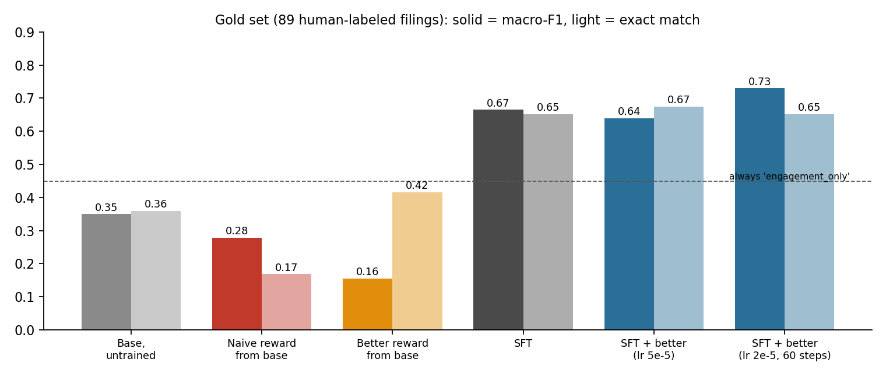
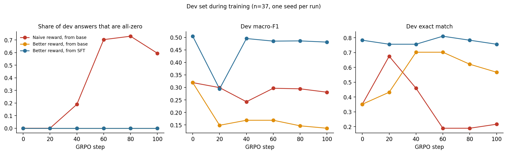

# Teaching a Small Model to Read 13Ds with RL, and Watching It Cheat

**James Foehner** · Part of the [activist target screener](../README.md) project · November 2026

## Summary

I trained a 1.5-billion-parameter open model (Qwen2.5-1.5B-Instruct) to tag the Item 4 text of SEC Schedule 13D filings with ten binary demand categories, such as board seats, a sale of the company, or a buyback. Labels from Claude Sonnet trained the model. 89 filings I labeled by hand were used only for testing.

Two results:

1. **Supervised fine-tuning does most of the work.** It lifts macro-F1 on the human-labeled test set from **0.35 to 0.665**. Reinforcement learning (GRPO) on top moved it to between 0.64 and 0.73, and none of those differences is statistically distinguishable from fine-tuning alone.
2. **RL from the untrained model finds shortcuts, and the headline metric hides them.** With a plain per-field accuracy reward, the model learned to answer "none of the categories" on 66 of 89 test filings. Accuracy stayed at 87%, because most fields are 0 for most filings. With a stricter set-overlap reward, the model collapsed to a single label instead, scoring **below a constant guess**. Starting RL from the fine-tuned model avoided collapse in both of my settings.

All results are one training run per condition on an 89-filing test set, so read them as demonstrations of failure modes, not as measured rates.

*Test-set results for every model. The dashed line is the exact-match rate of always answering `engagement_only`.*

## The task

Item 4 of a 13D is where an activist explains what it wants. I labeled each filing with whichever of ten categories apply: `board_seats`, `sale_or_review`, `breakup_spin`, `capital_return`, `operations_costs`, `management_change`, `governance`, `oppose_deal`, `capital_discipline`, and `engagement_only` (talks with management, nothing specific, never combined with another label). The labeling guide's central rule is to label intent, not the boilerplate paragraph reserving the right to do anything later.

Labels are imbalanced. `engagement_only` is on 45% of test filings, and three fields have 5 or fewer positives, so per-field scores for those are noisy.

## Data and method

- **Silver labels (training).** Claude Sonnet labeled several hundred filings using the labeling guide. It agreed with my hand labels about 83% of the time, which caps what training on it can teach.
- **Splits.** 342 train, 37 dev, and 89 gold filings. Gold is my own labeling of a 100-filing sample minus exclusions, and was never used for training or checkpoint selection.
- **Model.** LoRA adapters (rank 16) on all attention and MLP layers of Qwen2.5-1.5B-Instruct. The model outputs a JSON object with the ten fields.
- **SFT.** 3 epochs on the silver labels, learning rate 2e-4.
- **GRPO.** A small custom loop. For each batch of filings it samples 8 answers per filing, scores them, normalizes rewards within each group, and takes one on-policy gradient step. No KL penalty. Groups where all 8 answers score the same give no gradient and are skipped.
- **Rewards.**
  - *Naive:* the fraction of the ten fields answered correctly. A model that always says "none" scores about 0.84.
  - *Better:* Jaccard overlap between the predicted and true sets of positive labels, minus 0.2 if `engagement_only` is combined with another label. Unparseable answers score 0.
- **Metrics.** Macro-F1 over the ten fields, exact match on all ten fields, and mean per-field accuracy. Confidence intervals come from a paired bootstrap over test filings (2,000 resamples).

## Results

### Model comparison on the 89 gold filings

| Model | Macro-F1 | Exact match | Mean accuracy | What the answers look like |
|---|---|---|---|---|
| Base model, untrained | 0.349 | 36.0% | – | varied but often wrong |
| RL with naive reward, from base | 0.278 | 16.9% | 0.872 | all-zero on 66 of 89 |
| RL with better reward, from base | 0.156 | 41.6% | 0.849 | `board_seats` alone on 55, `engagement_only` alone on 33 |
| SFT | **0.665** | 65.2% | 0.935 | varied |
| SFT, then better reward (lr 5e-5, temp 1.2) | 0.640 | 67.4% | 0.939 | varied |
| SFT, then better reward (lr 2e-5, 60 steps) | **0.730** | 65.2% | 0.945 | varied |
| *Always `engagement_only`* | *0.062* | *44.9%* | *0.834* | *constant* |

### Failure mode 1: the naive reward rewards saying nothing

The naive reward gives full credit for every field answered 0 when the truth is 0. Since most fields are 0 for most filings, "none of them" already scores about 0.84, and the model moved toward it. By step 60 of 100, 70% of dev answers were all-zero. The naive reward on dev stayed between 0.87 and 0.93 the whole time, while the stricter reward fell from 0.73 (step 20) to 0.23–0.28 (steps 60–100).

On the gold set, the collapsed model answers all-zero on 66 of 89 filings (the fine-tuned models: 0 of 89). It still scores 87% accuracy. Its F1 on `engagement_only`, the most common label, is 0.00, and it scores zero on four other fields. A dashboard that tracked only accuracy would call this model healthy.

Against SFT, the collapsed model is significantly worse on every metric: macro-F1 −0.39 (95% CI [−0.49, −0.24]), exact match −0.48 [−0.60, −0.37], accuracy −0.06 [−0.08, −0.04].

*Dev-set metrics during the three RL runs. Single run each; dev has 37 filings, so individual points are noisy.*

### Failure mode 2: a better reward is still hackable

I expected the set-overlap reward to avoid this. From the untrained model it didn't, it just failed differently. By step 40 the model was answering exactly one label per filing, and from then on, in most batches, all 8 sampled answers agreed, so there was no gradient left to learn from. On the gold set it answers `board_seats` alone on 55 filings and `engagement_only` alone on 33, and gets 41.6% exact match, below the 44.9% of always guessing `engagement_only`. Macro-F1 is 0.156.

Dev exact match peaked at 70% during this run. That number came from the majority-class rate on a 37-filing dev set, and it looked like progress.

I haven't isolated why. The learning rate (5e-5) and temperature (1.2) I used were probably too aggressive for a from-scratch run with no KL penalty, but I didn't run that comparison.

### Control: the starting point protects against collapse

Same better reward, same learning rate and temperature, but starting from the fine-tuned model instead of the untrained one:

- It did not collapse. Positives per filing stayed between 1.05 and 1.30 on dev, and the gold answers are varied (46 `engagement_only`, 12 `board_seats`, 7 `operations_costs`, and others).
- It did not improve either. Macro-F1 is 0.640 against SFT's 0.665 (difference −0.026, 95% CI [−0.13, +0.10]). Exact match and accuracy differences are also within noise.

The starting point decides whether this reward collapses. Whether the reward itself is robust, I can't say from these runs.

### Did RL on top of SFT help?

The gentler run (lr 2e-5, 60 steps) reached macro-F1 0.730 against SFT's 0.665. The difference is +0.065 with a 95% CI of [−0.02, +0.17], so it's suggestive, not significant. Exact match is identical (65.2%).

Most of the gain comes from one field. `capital_discipline` went from F1 0.33 (recall 2 of 9) to 0.78 (recall 9 of 9). In the more aggressive control run, the same field went to 0.00. Both runs optimized the same reward, so my read is that aggressive settings pushed the model to drop its rarest, hardest label to avoid false positives, while the gentle run pushed the other way. With 9 positives and one seed each, I can't confirm that.

SFT's remaining weakness is recall. Its precision is 0.80 to 1.00 on most fields, but recall is 0.22 to 0.47 on five of them. It leaves labels off, which is the gap RL could close.

## Limitations

- **One training run per condition.** I don't know the seed-to-seed variation. The dev trajectories wobble substantially, for example macro-F1 dipping to 0.29 at one checkpoint in the control run and fully recovering.
- **Small test set.** 89 filings, with 3 to 9 positives for several fields. Per-field F1 for those can swing by 0.2 from a single filing.
- **Silver labels cap the ceiling.** The model learns from labels that agree with mine about 83% of the time. RL against those labels can at best approach that labeler.
- **Runs differ in more than one setting.** The aggressive and gentle runs differ in learning rate, temperature, batch size and step count, so I can't attribute the `capital_discipline` difference to any one of them.
- **No KL penalty.** Standard RL setups usually keep the model close to its starting point, which would likely have limited both collapses. I left it out to keep the loop simple, and so the results describe unconstrained RL.

## Takeaways

- Report more than one metric. Accuracy hid the first collapse, and exact match hid the second.
- Compare against constant baselines. The always-`engagement_only` baseline (44.9% exact match) is what showed the second model was no better than guessing.
- Starting point matters more than the reward in these runs. Both rewards collapsed from the base model and neither collapsed from SFT.
- Cheap supervised training came first and did most of the work. The RL stage added at most a modest gain on one rare label.

## Reproducing

Scripts are in [`rl/`](../rl): `build_training_data.py` (project root) builds the splits, `sft_train.py` and `grpo_train.py` train, `baseline_eval.py` scores on gold, `bootstrap_compare.py` runs the paired bootstrap, and `plot_phase5.py` makes the figures. Predictions and training logs are in `data/rl/`. Training ran on a Colab GPU in about an hour per RL run.
